<div align="center">
  
  <h1>QuantForge</h1>
  <p><strong>Every decision explained. Every order gated.</strong></p>
  <p>An explainable AI-assisted algorithmic trading platform for the Wallex Agentic AI Hackathon.</p>
  <p>پلتفرم تحلیل و تصمیم‌گیری شفاف، با داشبورد فارسی و کنترل‌های مستقل ریسک</p>


[Product tour](#product-tour) · [Quick start](#quick-start) · [Architecture](#architecture) · [Evidence & safety](#evidence--safety)
</div>

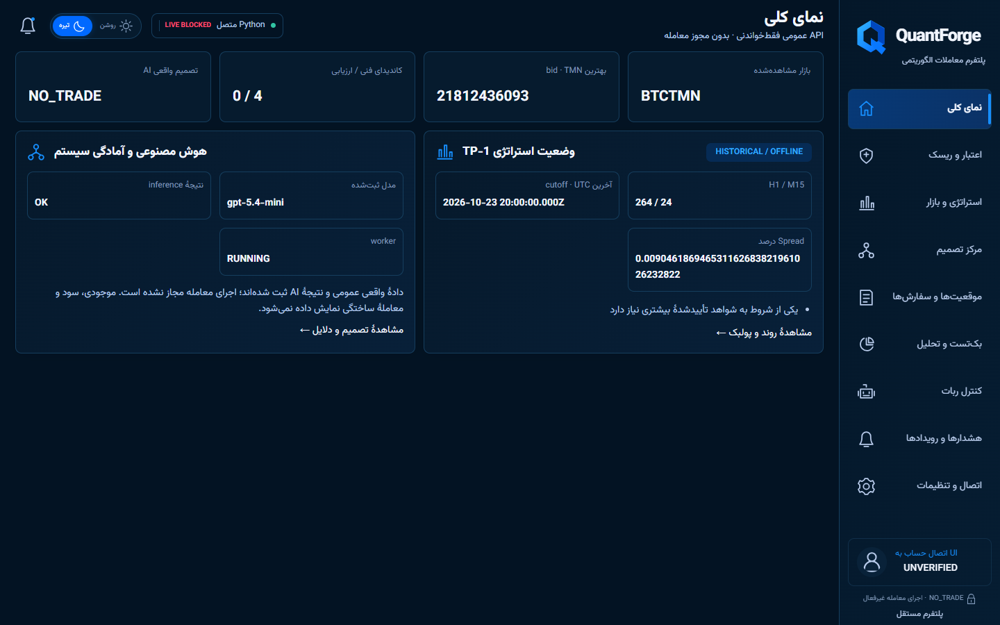

**Working public-market observation. Real BoxAPI inference. No claimed live fills or returns.**
QuantForge combines validated Wallex candles and order-book observations with deterministic TP-1 diagnostics,
a structured AI review, independent risk controls and an auditable execution foundation.
The connected dashboard reports evidence and missing prerequisites; it never turns partial checks into trading approval.

## Product tour

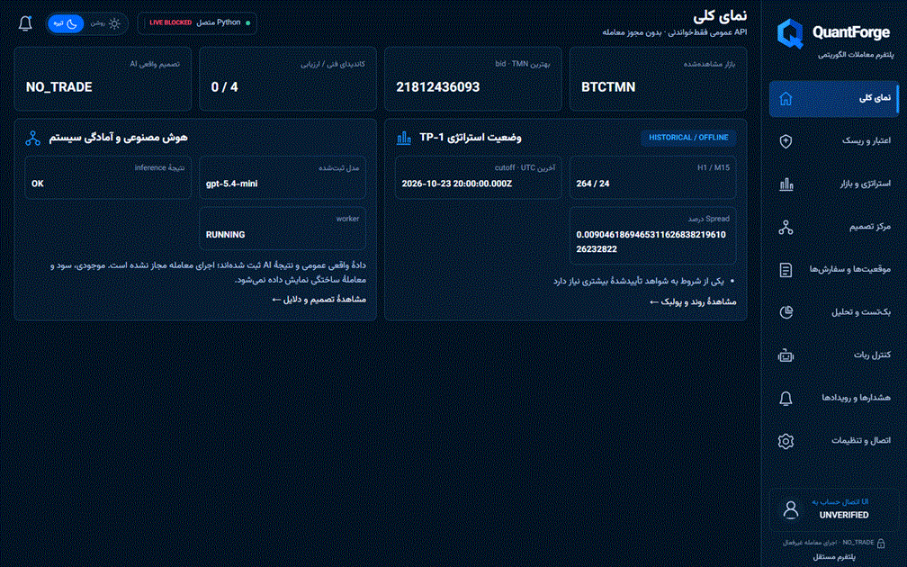

*12-second tour: Overview → Strategy → Decision Center → Credit & Risk → Orders.
Captured from the actual connected localhost application, in Persian RTL dark mode.
These are timestamped captures, not a live data feed. The Orders lifecycle is explicitly SIMULATION / HTTP_MOCK.*

| Strategy & Market | AI Decision Center |
| --- | --- |
| 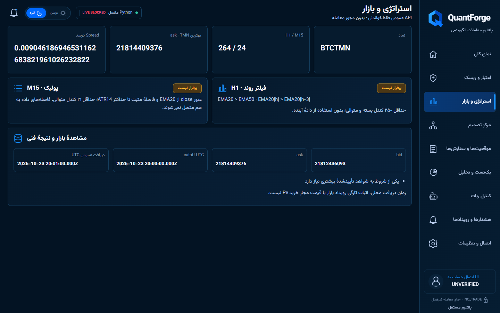 | 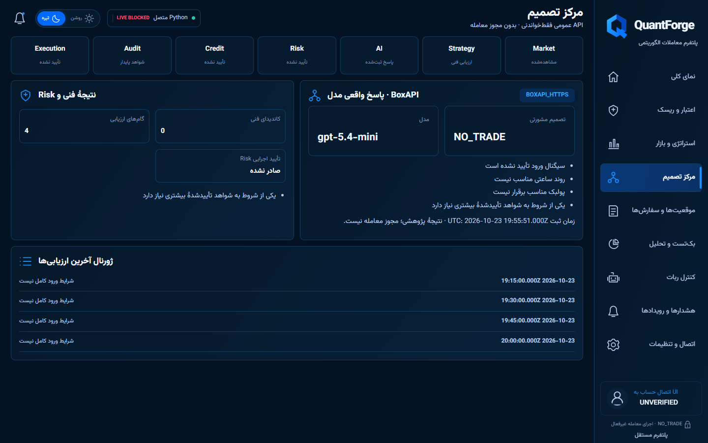 |
| Closed H1/M15 candle requirements, trend, pullback and public bid/ask evidence. | Provider/model evidence, advisory reasons and the technical evaluation journal. |

| Credit & Risk | Positions & Orders |
| --- | --- |
| 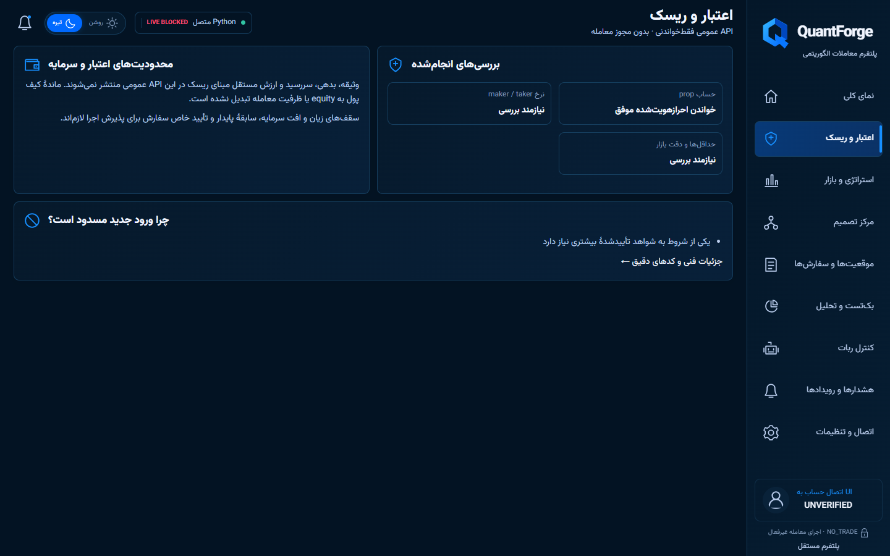 | 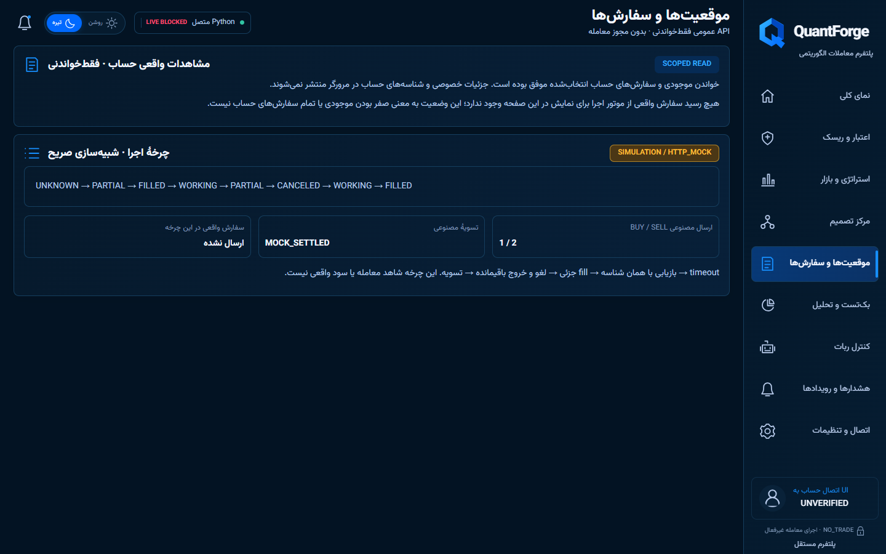 |
| Verified read status is separated from unavailable credit and risk-equity evidence. | Actual read-only status and a separately labelled synthetic HTTP lifecycle. |

<details>
<summary><strong>Analytics, operations and settings — all nine routes</strong></summary>

| Backtest & Analytics | Robot Control |
| --- | --- |
| 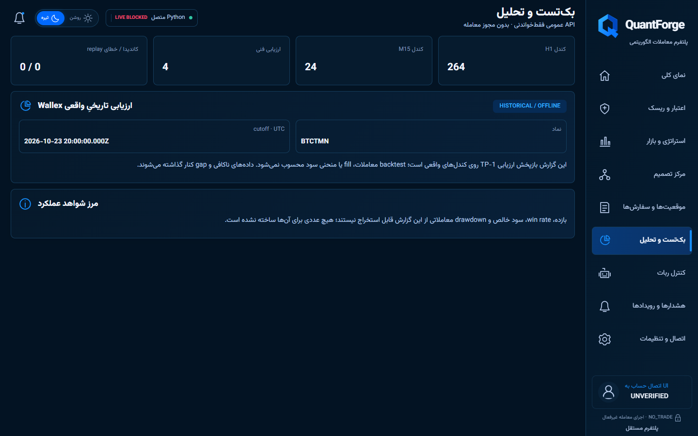 | 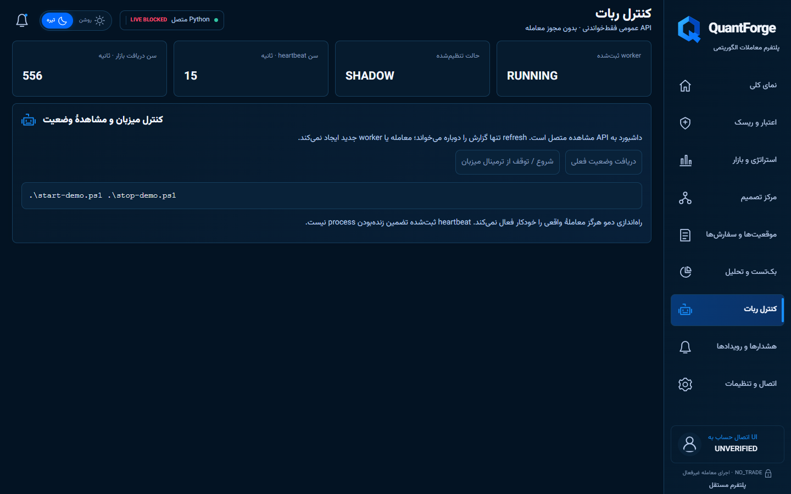 |

| Alerts & Events | Connections & Settings |
| --- | --- |
| 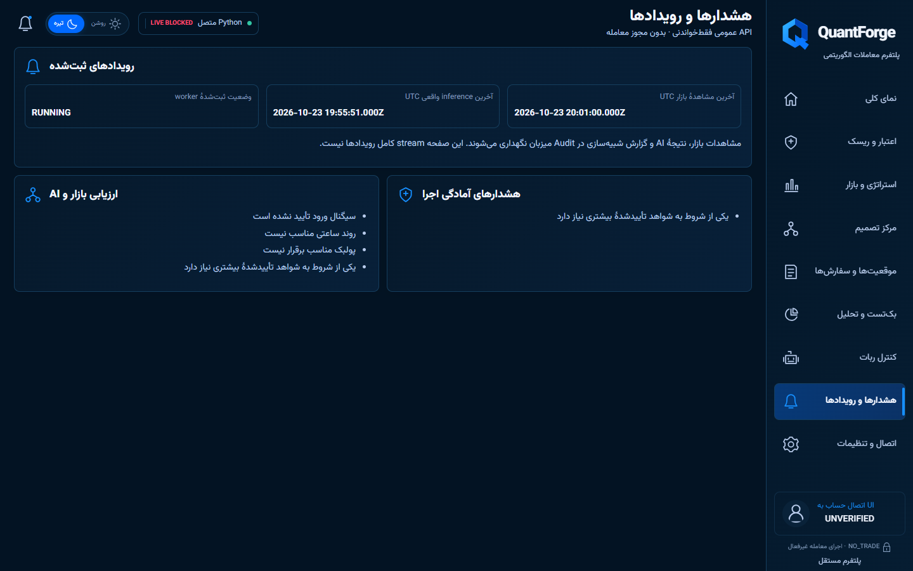 | 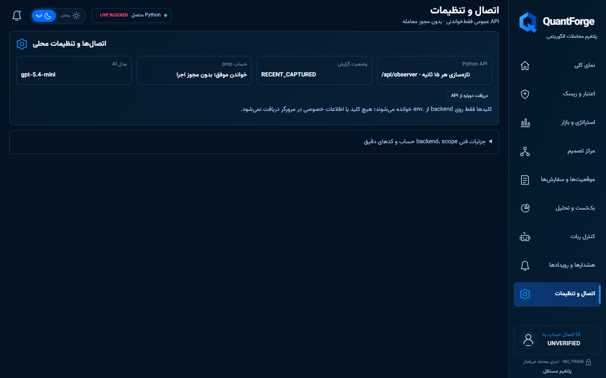 |

</details>

### Persian RTL, on mobile too

<p align="center">
  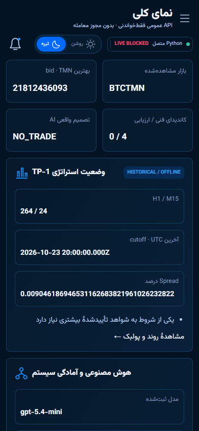
  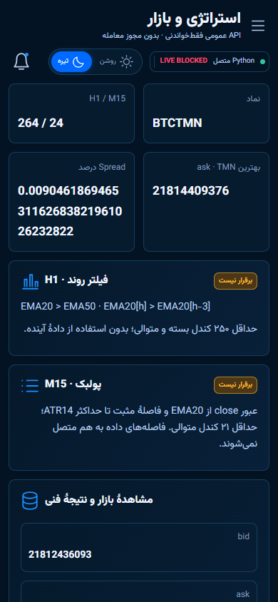
  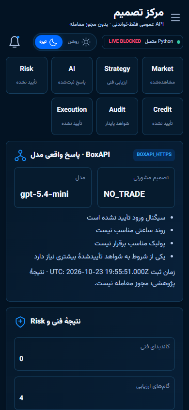
</p>

The same application supports persistent dark/light themes, bundled Vazirmatn typography,
responsive navigation and read-only refresh. The separate `?view=demo` presentation uses
explicitly labelled synthetic fixtures; **none of the captures above use that mode**.

## What is implemented

| Capability | What the code actually does |
| --- | --- |
| **Wallex market evidence** | Public OHLCV collection, native H1 ingestion, strict validation, gap-aware M15 segmentation, public depth/spread diagnostics and source hashes. |
| **TP-1 technical assessment** | Decimal SMA-seeded EMA, Wilder ATR14, H1 trend, M15 pullback and proposed initial stops, with causal closed-candle cutoffs. |
| **Real AI integration** | BoxAPI `gpt-5.4-mini` structured observation review and candidate retain/veto support; provider/model, evidence hashes and timestamps are audited. AI is advisory. |
| **Risk & credit** | Explicit Pe, cost-aware sizing, daily-loss/drawdown and portfolio checks, offline credit evidence; missing or stale evidence fails closed. No equity inferred from balances. |
| **Execution foundation** | Scoped HTTPS BUY/SELL operations, durable client IDs, partial fills, timeout/restart recovery, protective-exit and fee-aware settlement mechanisms. Development verification uses injected HTTP. |
| **Replay & Shadow** | Existing replay/backtest infrastructure and actual TP-1 technical journals; gaps are never joined to manufacture history. |
| **Audit & dashboard** | Persistent SQLite evidence, timestamps and rejection reasons, a read-only Python HTTP API and nine React routes polling every 15 seconds. |

### The actual TP-1 rules

- **H1 trend:** `EMA20[h] > EMA50[h]` and `EMA20[h] > EMA20[h−3]`, after at least **250 consecutive completed H1 candles**.
- **M15 pullback:** previous close at/below EMA20, current close above EMA20, and `0 < close − EMA20 ≤ ATR14`; at least **21 consecutive completed M15 candles**.
- **Proposed long stop:** `min(lowest_low_last3 − 0.1 × ATR14, Pe − 1.5 × ATR14)`. **Pe is explicitly supplied**, never silently inferred from a candle close or ask.
- A technical candidate is research evidence, **not** an executable order. Risk, account, market, exit and owner-authorization gates remain independent.

## Architecture

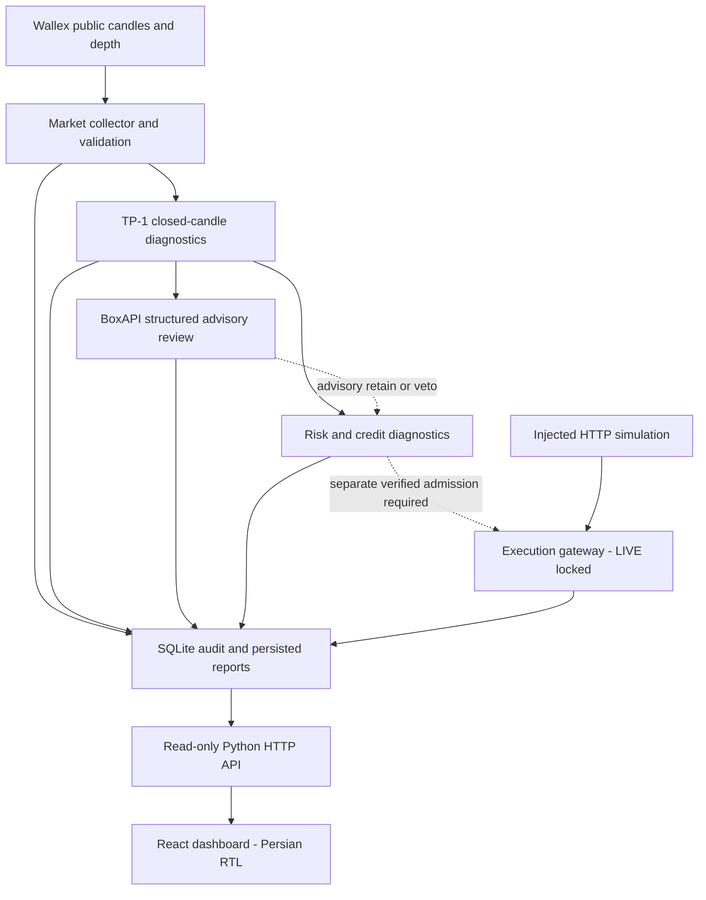

The API uses Python's standard-library HTTP server, **not FastAPI**. Private credentials and
raw account evidence stay in the backend; the public projection exposes sanitized status categories.
AI approval cannot bypass deterministic risk or authorize an exchange write.

## Quick start

**Requirements:** Windows PowerShell, Python **3.11+**, Node.js **22.12+**, npm.

```powershell
git clone https://github.com/SetayeshSamani/quant-forge.git
cd quant-forge
# First setup only; NEVER overwrite an existing private .env.
if (!(Test-Path .env)) { Copy-Item .env.example .env }
# Edit .env locally with your private keys and verified sub-account identity.
# Keep TRADING_MODE=SHADOW and LIVE_TRADING_ENABLED=false.
.\start-demo.ps1
```

Open **http://127.0.0.1:8080**. The script installs frontend dependencies if needed,
builds the UI and launches the managed backend. Public observations are collected;
configured account checks are GET-only. When configured, one real AI observation assessment
runs per launch; UI refresh does not repeat paid inference.

```powershell
.\stop-demo.ps1   # Cooperative shutdown; evidence and audit data are preserved.
.\start-demo.ps1  # Restart reuses local configuration and persistent DATA_DIR.
```

**Configuration precedence:** process environment → root `.env` → safe defaults.
Keys are loaded in backend memory, never passed to npm or the browser. Missing credentials
or evidence produces explicit unavailable/blocked states. Even LIVE-labelled configuration
does **not** enable real orders through the demo supervisor.

### Offline and execution demonstrations

```powershell
# Synthetic fixture walkthrough: no API requests, credentials or real trades.
python -B -m wallex.shadow.tp1_demo
# Injected HTTP lifecycle: BUY → partial fill → recovery → SELL → settlement.
python -B -m wallex.execution.simulation --simulate
# Saved genuine public data: explicit files, symbol, UTC cutoff and provenance.
python -B -m wallex.shadow.offline_tp1 --help
# Fee-aware research composition; assumptions must be explicit.
python -B -m wallex.shadow.release_evidence --help
```

See [offline TP-1 inputs](docs/OFFLINE_TP1.md), [observer/API setup](docs/OBSERVER_DASHBOARD.md)
and [worker/preflight details](docs/AGENT_RUNTIME.md). Downloaded market data is not committed.

## Evidence & safety

| Evidence | Verified result and boundary |
| --- | --- |
| **Genuine Wallex technical replay** | Captured BTCTMN assessment: **264 H1 / 24 M15**, **4 evaluated / 0 eligible / 0 errors**. This is historical technical assessment, not a trade-performance backtest. |
| **Real model inference** | BoxAPI HTTPS **200**, `gpt-5.4-mini`, parsed response, genuine observation hashes and verified audit readback were observed before this showcase at source `d384adb`. Correct endpoint: `/ai/v1/chat/completions`. |
| **Execution lifecycle** | BUY/FILL/SELL/reconciliation and recovery exercised with **HTTP_MOCK**. These are not real exchange fills or realized returns. |
| **Regression history** | Before this documentation/media task: **620 Python tests** and **11 browser tests** passed on the pre-showcase release; 22 focused execution/risk tests also ran on Python 3.11. |
| **This change** | Documentation and actual browser captures only. **No test suite or build was run for this showcase.** |

All executable dashboard actions remain **NO_TRADE**, `executable_ready=false`.
LIVE is **NO-GO** until account trade permissions, credit obligations, fee-debit policy,
complete market limits, verified executable quote freshness, independent risk equity/loss
history, reconciliation and a specific owner-approved order are established.
A limit-based protective exit cannot guarantee a fill.

The unresolved prop active-package HTTP 401 is separate from successful scoped Spot GETs;
a successful authenticated read never proves trade permission. Provider receipt time is
not a provider market-event timestamp. No profits, balances, trade counts or investment
returns are fabricated.

### Reproduce checks when reviewing code

```powershell
# Canonical wallex.* module suite, including nested modules:
$modules = @(rg --files wallex -g 'test_*.py' | Sort-Object | ForEach-Object {
    ($_ -replace '[\\/]', '.') -replace '\.py$', ''
})
python -B -m unittest $modules -q
$env:PW_BROWSER_CHANNEL = 'msedge'  # Installed Edge, or use Playwright Chromium.
npm --prefix frontend test
npm --prefix frontend run check
npm --prefix frontend run build
```

These commands are provided for reproduction, not claimed as a fresh showcase test run.

## Deployment

**Connected release:** use the root Dockerfile, a single worker, port **8080**, persistent
**`/data`**, and a pinned source SHA. Explicit `--fetch-public` opts into public collection.
Local Docker startup/health, public observer collection, stop/restart and persistence were
previously verified; **Liara deployment itself is not claimed**.
Follow [exact source/Docker commands](docs/RELEASE_REPRODUCIBILITY.md).

**Static UI only:** root `frontend`, install `npm ci`, build `npm run build`, output `dist`.
It needs a separate same-origin Python API/proxy for real observations; static hosting
alone cannot run the collector. Hash navigation requires no SPA route rewrite.
Never put secrets in `VITE_*`, frontend configuration or public deployment artifacts.

## Project structure

```text
frontend/             React, TypeScript, Vite, RTL UI and browser checks
wallex/market/        Public data collection, validation, provenance and replay
wallex/strategy/      TP-1 EMA/ATR, trend, pullback, stops and frame diagnostics
wallex/ai_provider/   BoxAPI client and auditable structured advisory review
wallex/risk/          Sizing, loss, portfolio, credit and admission checks
wallex/execution/     Scoped transport, durable lifecycle and HTTP simulation
wallex/audit/         SQLite ledger and evidence persistence
wallex/shadow/        Replay journals and offline integration workflows
wallex/backtest/      Existing fee-aware research engine
wallex/infra/         Configuration, read-only preflight, worker and HTTP API
docs/                 Evidence, runbooks, screenshots and product preview
```

## Security

- `.env`, credential backups and sensitive runtime files are excluded from Git. Never share or commit keys.
- Explicit sub-account scope; no automatic fallback to a main Spot account or Margin credentials.
- Backend-only private data; sanitized public API, no raw account responses or account identifiers in the UI.
- No withdrawals, plan activation, speculative test orders or implicit LIVE activation.
- Unknown outcomes and incomplete evidence block admission. AI failures do not create approval.

## Five-minute hackathon demo

1. **0:00–0:45 — Overview:** show actual public observations, captured timestamps and permanent LIVE BLOCKED status.
2. **0:45–1:40 — Strategy:** explain H1 trend, M15 pullback, gap rejection and the legitimate zero-candidate result.
3. **1:40–2:30 — Decision Center:** show the actual BoxAPI model/advisory result and technical journal; distinguish inference from order authorization.
4. **2:30–3:30 — Risk & Orders:** separate scoped reads from unavailable credit/risk evidence; show the explicitly labelled HTTP_MOCK lifecycle.
5. **3:30–4:20 — Analytics & Audit:** distinguish technical replay from profitability, then expand Connections for evidence hashes and source identity.
6. **4:20–5:00 — Reproducibility:** show startup, safe shutdown, persistent audit and exact live blockers. Do not reveal `.env`, private responses or credentials.

[Competition submission & evidence matrix](docs/HACKATHON_SUBMISSION.md) ·
[Reproducibility runbook](docs/RELEASE_REPRODUCIBILITY.md) ·
[Frontend documentation](frontend/README.md)
